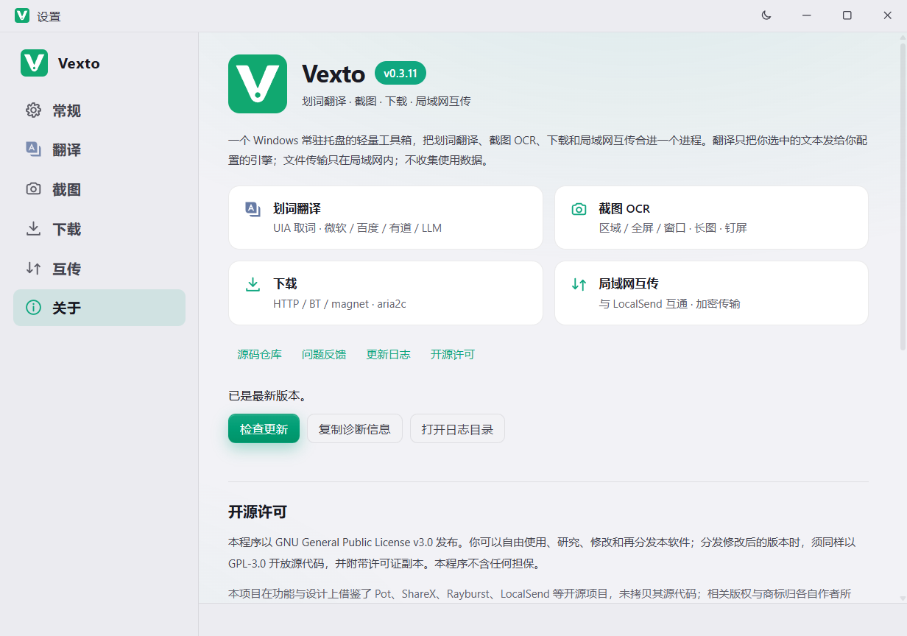
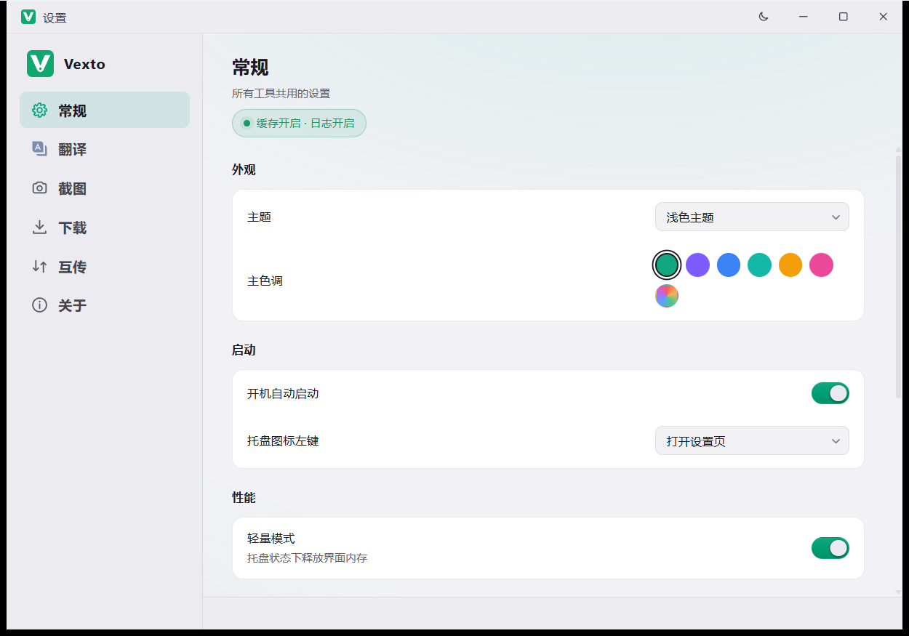

<div align="center">


<h1>Vexto</h1>

<hr />

A lightweight Windows tray toolbox that combines select-to-translate, screenshot OCR, downloads and LAN file transfer in one process.

[简体中文](README.md) · [English](README.en.md) · [Download Releases](https://github.com/Ruxsmiles/vexto/releases) · [Feedback Issues](https://github.com/Ruxsmiles/vexto/issues)


</div>

**Built to stay light.** The tray process does not keep WebView2 alive; windows are created only when you actually open them.

## Features

| Capability | Description |
|---|---|
| Select-to-translate | Select text and press the hotkey; a translation card appears next to the cursor. Microsoft Translator is built in; Baidu / Youdao / OpenAI-compatible instances can be added |
| Screenshots | Region / fullscreen / active-window capture; OCR-translate a selected region; scrolling capture; pin to screen; annotate directly in the selection (rectangle / ellipse / arrow / pen / text / mosaic, with select / move / resize / edit) and trim edges in preview; fullscreen captures show a thumbnail confirmation |
| Downloads | HTTPS / BT / magnet downloads through an aria2c sidecar that exits when idle |
| Browser takeover | With [Vexto Connect](https://github.com/Ruxsmiles/vexto-connect) installed, downloads from Edge / Chrome / Firefox and Chromium-based browsers can be handed to Vexto |
| LAN transfer | Interoperates with official LocalSend: receive / send / history / verification |
| UI language | Simplified Chinese / English / 日本語 / 한국어 / Español; follows the system by default and switches instantly in Settings |
| Appearance | Light / Dark / Follow system, six accent colors plus a color picker |

## Screenshots



*About page: version, feature entries and update check*



*General settings: theme, accent color, startup and performance*

## Installation

Run [Vexto_0.5.4_x64-setup.exe](https://github.com/Ruxsmiles/vexto/releases/download/v0.5.4/Vexto_0.5.4_x64-setup.exe). The installer installs per-user (`%LOCALAPPDATA%`) and **lets you choose a custom install path**; administrator rights are not required.

The current installer is **21.30 MiB** (includes the PaddleOCR model, LZMA-compressed); the installed program directory is about 42 MB.

> Starting with 0.5.0, the installer/program publisher is **Ruxsmiles**. When upgrading from 0.4.0 or earlier, confirm the install directory in the installer; a custom path from the old version is not carried over automatically.

Browser download takeover requires the companion extension; see “Browser download takeover” below.

## Browser download takeover

Vexto does not inject itself into browsers. To route web downloads into Vexto, install the companion extension **Vexto Connect** and enable “Enable takeover” in Vexto Settings → Downloads → Advanced → Browser takeover.

Supported:

- Microsoft Edge 109+
- Google Chrome 109+
- Mozilla Firefox 115+
- Many Chromium-based browsers popular in China (360, QQ, Sogou, etc.)

Extension repository and installation guide: <https://github.com/Ruxsmiles/vexto-connect>

After installing the extension, confirm the host `127.0.0.1` and port `29110` on its options page; if Vexto has an extension secret configured, keep both sides identical. Web downloads are then handed to Vexto automatically, falling back to the browser when Vexto is unavailable.

## Updates

Settings → About → Update can check for new versions and install them directly; the tray context menu also has “Check for updates”.

- At most one silent check every 24 hours after startup; when a new version is found, no popup appears — only the About page and tray menu show a hint.
- Clicking “Update now” closes Vexto and installs in place over the existing installation (**no need to uninstall first**), then restarts automatically; configuration and install directory are preserved.
- In mainland China the installer is downloaded through `gh-proxy.org` by default (switch to direct or a custom proxy in About → Update → Download source); the GitHub-published sha256 is verified after download.

## First use

1. Right-click the tray icon → Settings.
2. Translation uses “Microsoft Translator” by default; add and select Baidu / Youdao / OpenAI-compatible engines in Service management when needed.
3. Select-to-translate: press `Ctrl+Alt+T`; region capture: press `Ctrl+Alt+A` and drag a region.
4. Translate, screenshot, download and transfer are all enabled by default; turn any of them off in Settings → General → Tools and its hotkeys and tray entries stop working.

## Hotkeys

| Function | Default hotkey |
|---|---|
| Select-to-translate | `Ctrl+Alt+T` |
| Input translation | `Ctrl+Alt+I` |
| Screenshot OCR translation | `Ctrl+Alt+S` |
| Region capture | `Ctrl+Alt+A` |
| Fullscreen capture | `Ctrl+PrintScreen` |
| Download | `Ctrl+Alt+D` |

All can be changed in Settings → General → Shortcuts; PrintScreen combinations may be occupied by the system or other software, and a registration failure is reported when saving.

When a capture is done, press `L` to start scrolling capture with the current selection; if scrolling capture fails, the first frame is kept and can still be saved / copied / pinned / previewed.

## Memory usage

Reference values from the Windows Task Manager “Memory” column; actual numbers vary with the system, WebView2 version and page content:

| State | Main process | WebView2 group | Total |
|---|---|---|---|
| Tray resident, no window | about 1–2 MB | 0 | about 1–2 MB |
| Settings window open | about 6–7 MB | about 87 MB | about 93 MB |
| Window closed (lite mode on) | about 1–2 MB | 0 | about 1–2 MB |
| Window closed (lite mode off) | about 6–7 MB | about 87 MB (suspended) | about 93 MB |
| Installer | — | — | **21.30 MiB** |

Task Manager groups WebView2 child processes under “WebView2 manager”, separate from the main process. With “Lite mode” enabled, closing a window releases WebView2 (lower memory, slightly slower next open); with it disabled, windows are kept suspended for faster reopening.

## Known limitations

- Windows 10 1809+ / Windows 11.
- Chinese OCR requires the Paddle model (bundled) or the system Chinese OCR language pack; vertical text, stylized fonts and low-resolution images are outside its capabilities.
- Scrolling capture requires the whole selected area to scroll together; if only part of it scrolls, capture fails and falls back to the first frame.
- In-app updates close the program and install in place, preserving configuration; you can also exit and run a new installer manually.
- The installer does not configure the firewall automatically.
- Screenshots treat the virtual screen as one image; multi-monitor setups are captured as a single desktop.

## Upgrade

1. Tray context menu → Exit.
2. Run the new `Vexto_<version>_x64-setup.exe` and install over the existing version.
3. Configuration stays in `%APPDATA%\vexto\config.json`; uninstalling keeps that file by default.

## Development and build

```powershell
$env:PATH = "$env:USERPROFILE\.cargo\bin;$env:PATH"

npm install                                  # first time only: install frontend dependencies
npm run build                                # frontend output goes to ui/
cargo build --release                        # artifact: target\release\lightbox.exe
cargo clippy --release -- -D warnings        # must be warning-free
cargo test
cargo tauri build                            # NSIS: target\release\bundle\nsis\
powershell -File scripts\measure-mem.ps1     # memory measurement (the app must be running)
```

Tech stack: Rust + Tauri 2 + Vue 3, with the frontend built by Vite into plain static files.

> Downloads require an aria2c sidecar; its binary is not committed. Before building, place aria2c at
> `src-tauri/binaries/aria2c-x86_64-pc-windows-msvc.exe` (version in `src-tauri/licenses/aria2-VERSION.txt`).

## Layout

```
scripts/           build.ps1 / measure-mem.ps1 / gen-icons.ps1
src-tauri/         Rust sources, models, third-party licenses (aria2c must be added manually)
frontend/          Vue 3 sources and i18n catalogs
ui/                built frontend output (read directly by Tauri)
```

Development and build conventions are documented in module comments under `src-tauri/` and `frontend/`.

## Project links

- Source: <https://github.com/Ruxsmiles/vexto>
- Downloads: <https://github.com/Ruxsmiles/vexto/releases>
- Browser extension: <https://github.com/Ruxsmiles/vexto-connect>

Development documents are maintained separately and are not published with this repository.

## License

Third-party components and their license texts are in `src-tauri/licenses/`:

- aria2c: GPLv2 (`aria2-COPYING` / `aria2-VERSION.txt`)
- PaddleOCR PP-OCRv4 model: Apache-2.0 (`paddleocr-models-NOTICE.txt`)
- pure-onnx-ocr: Apache-2.0 (`pure-onnx-ocr-Apache-2.0.txt`)

This program is released under **GNU GPL-3.0**; see `LICENSE` at the repository root. Third-party components remain under their respective licenses.

**Disclaimer**: This program is provided “as is”, without any express or implied warranty. Any direct or indirect loss, data loss, service interruption or legal risk arising from its use is borne by the user. Please comply with local laws and third-party service terms.
