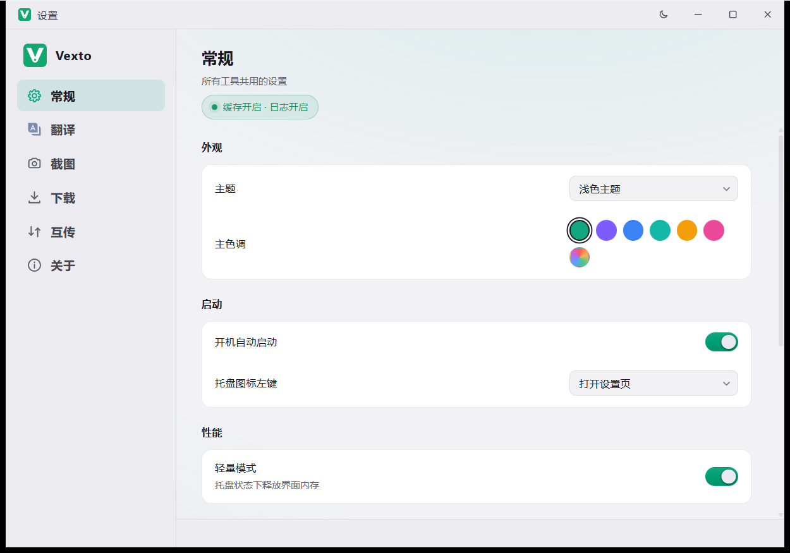

# Vexto

一个 Windows 常驻托盘的轻量工具箱，把划词翻译、截图、下载、局域网传文件合进一个进程。

**卖点：轻。** 托盘常驻不拉 WebView2；只有真正打开窗口时才创建。

## 功能

| 能力 | 说明 |
|---|---|
| 划词翻译 | 选中文字按热键，光标旁出译文卡片；默认内置微软翻译；也可添加百度 / 有道 / OpenAI 兼容实例 |
| 截图 | 区域 / 全屏 / 活动窗口截图；框选区域 OCR 翻译；滚动长图；钉屏；选框内直接标注（矩形 / 椭圆 / 箭头 / 画笔 / 文字 / 马赛克，支持选中 / 移动 / 缩放 / 文字编辑）并预览裁头尾；全屏截图右下角缩略图反馈 |
| 下载 | HTTPS / BT / magnet 下载，aria2c sidecar，空闲自动退出 |
| 浏览器接管 | 安装 [Vexto Connect](https://github.com/Ruxsmiles/vexto-connect) 后，Edge / Chrome / Firefox 与国内 Chromium 套壳浏览器的下载可交给 Vexto |
| 局域网传文件 | 与官方 LocalSend 互通，接收 / 发送 / 历史 / 校验 |
| 界面语言 | 简体中文 / English / 日本語 / 한국어 / Español，默认跟随系统，设置里即时切换 |
| 外观 | 明亮 / 暗色 / 跟随系统，六种主色调 + 取色器 |

## 界面预览


*关于页：版本、功能入口与更新检查*



*常规设置：主题、主色调、启动与性能*

## 安装

运行 [Vexto_0.5.0_x64-setup.exe](https://github.com/Ruxsmiles/vexto/releases/download/v0.5.0/Vexto_0.5.0_x64-setup.exe)。安装器按当前用户安装（`%LOCALAPPDATA%`），**可以选择自定义安装路径**，不需要管理员权限。

当前安装包 **21.30 MiB**（含 PaddleOCR 模型，LZMA 压缩后）；安装后程序目录约 42 MB。

浏览器接管下载需要另装配套扩展，见下方「浏览器接管下载」。

## 浏览器接管下载

Vexto 本身不直接注入浏览器。要让网页下载进入 Vexto，需要安装配套浏览器扩展 **Vexto Connect**，并在 Vexto 设置 → 下载 → 高级 → 浏览器插件接管 中开启「启用接管」。

支持：

- Microsoft Edge 109+
- Google Chrome 109+
- Mozilla Firefox 115+
- 多款国内 Chromium 套壳浏览器（360、QQ、搜狗等基于 Chromium 的版本）

扩展仓库与安装说明：<https://github.com/Ruxsmiles/vexto-connect>

安装扩展后，在扩展选项页确认主机 `127.0.0.1`、端口 `29110`；如果 Vexto 设置了插件密钥，两边保持一致。之后网页下载会自动交给 Vexto，Vexto 不可用时回落到浏览器下载。

## 更新

设置 → 关于 → 更新可以检查新版本并直接安装；托盘右键菜单也有「检查更新」。

- 启动后每 24 小时最多静默检查一次；发现新版本不弹窗，只在关于页和托盘菜单提示。
- 点「立即安装」会关闭 Vexto，以覆盖方式原地安装（**不需要先卸载**），完成后自动重启；配置与安装目录保留。
- 国内网络下安装包默认经 `gh-proxy.org` 下载（可在「关于 → 更新 → 下载线路」切换直连或自定义代理），下载完成后用 GitHub 公布的 sha256 校验安装包。

## 首次使用

1. 托盘图标右键 → 设置。
2. 翻译默认使用「微软翻译」；需要百度 / 有道 / OpenAI 兼容时再在「服务管理」里添加并选中。
3. 划词翻译：选中文字按 `Ctrl+Alt+T`；截图 OCR 翻译：按 `Ctrl+Alt+S` 框选。
4. 截图工具默认关闭，设置 → 截图 → 启用后热键才注册。

## 热键

| 功能 | 默认热键 |
|---|---|
| 划词翻译 | `Ctrl+Alt+T` |
| 输入翻译 | `Ctrl+Alt+I` |
| 截图 OCR 翻译 | `Ctrl+Alt+S` |
| 区域截图 | `Ctrl+Alt+A` |
| 全屏截图 | `Ctrl+PrintScreen` |
| 下载 | `Ctrl+Alt+D` |

全部可在设置页改；PrintScreen 组合可能被系统或其他软件占用，保存时会提示注册失败。

截图完成态还可以按 `L` 用当前选区直接进入滚动截图；滚动截图失败时会保留第一帧，仍可保存 / 复制 / 钉住 / 预览。

## 资源占用

以下为 Windows 任务管理器「内存」列的参考值，实际会随系统、WebView2 版本和页面内容变化：

| 状态 | 主程序 | WebView2 进程组 | 合计 |
|---|---|---|---|
| 托盘常驻，无窗口 | 约 1–2 MB | 0 | 约 1–2 MB |
| 打开设置页 | 约 6–7 MB | 约 87 MB | 约 93 MB |
| 关闭窗口（轻量模式开） | 约 1–2 MB | 0 | 约 1–2 MB |
| 关闭窗口（轻量模式关） | 约 6–7 MB | 约 87 MB（挂起） | 约 93 MB |
| 安装包 | — | — | **21.22 MiB** |

任务管理器会把 WebView2 子进程归入「WebView2 管理器」组，主程序与它分开显示。开启「轻量模式」后，关闭窗口会释放 WebView2，内存更低，下次打开稍慢；不开启时窗口会挂起复用，再次打开更快。

## 已知限制

- Windows 10 1809+ / Windows 11。
- 中文 OCR 需要 Paddle 模型（随包）或系统中文 OCR 语言包；竖排、艺术字、低分辨率识别差是能力边界。
- 滚动截图要求选区内的画面整体滚动；只有一半区域滚动时会失败并回退到第一帧。
- 不做自动更新：升级时托盘右键退出，运行新的 setup 覆盖安装，`%APPDATA%\vexto\config.json` 会保留。
- 安装器不自动配置防火墙。
- 截图按虚拟屏幕处理，多显示器时是一整张。

## 升级

1. 托盘右键 → 退出。
2. 运行新的 `Vexto_<版本>_x64-setup.exe` 覆盖安装。
3. 配置保留在 `%APPDATA%\vexto\config.json`；卸载默认也保留该文件。

## 开发与构建

```powershell
$env:PATH = "$env:USERPROFILE\.cargo\bin;$env:PATH"

cargo build --release                        # 产物: target\release\lightbox.exe
cargo clippy --release -- -D warnings        # 必须零警告
cargo test
cargo tauri build                            # NSIS: target\release\bundle\nsis\
powershell -File scripts\measure-mem.ps1     # 内存实测（进程需在跑）
```

技术栈：Rust + Tauri 2，前端纯静态 HTML/CSS/JS —— 没有 npm、Vite、TypeScript 或前端框架。

> 下载功能依赖 aria2c sidecar，仓库不提交该二进制。构建前把 aria2c 放到
> `src-tauri/binaries/aria2c-x86_64-pc-windows-msvc.exe`（版本见 `src-tauri/licenses/aria2-VERSION.txt`）。

## 目录

```
scripts/           build.ps1 / measure-mem.ps1 / gen-icons.ps1
src-tauri/         Rust 源码、模型、第三方许可（aria2c 需手动放置）
ui/                纯静态前端
```

开发与构建约定见 `src-tauri/` 与 `ui/` 内的模块注释。

## 项目地址

- 代码仓库：<https://github.com/Ruxsmiles/vexto>
- 下载：<https://github.com/Ruxsmiles/vexto/releases>
- 浏览器扩展：<https://github.com/Ruxsmiles/vexto-connect>

开发文档单独维护，不随本仓库发布。

## 许可

第三方组件及其许可原文在 `src-tauri/licenses/`：

- aria2c：GPLv2（`aria2-COPYING` / `aria2-VERSION.txt`）
- PaddleOCR PP-OCRv4 模型：Apache-2.0（`paddleocr-models-NOTICE.txt`）
- pure-onnx-ocr：Apache-2.0（`pure-onnx-ocr-Apache-2.0.txt`）

本程序以 **GNU GPL-3.0** 协议开源，全文见仓库根 `LICENSE`。第三方组件仍按各自许可分发。

**免责声明**：本程序按「现状」提供，不附带任何明示或暗示的担保。使用本程序产生的任何直接或间接损失、数据丢失、服务中断或法律风险，均由使用者自行承担。请遵守当地法律法规及第三方服务条款。
